<p align="center">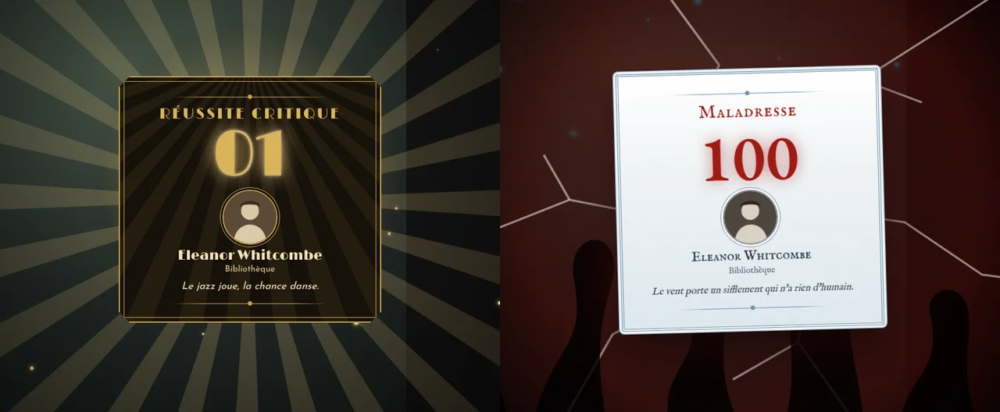</p>

<h1 align="center">Critiques du Mythe</h1>

<p align="center">
  <strong>Des cartes plein écran pour les réussites critiques et les maladresses de L'Appel de Cthulhu</strong><br>
  CoC7 · Investigateurs de l'Ombre · Foundry VTT v13 et v14
</p>

<p align="center">
  
  
  
</p>

---

## En bref

Quand un investigateur obtient un **01** ou une **maladresse**, toute la table le voit : une carte s'affiche au milieu de l'écran, avec une animation, un son et un tremblement de l'écran. Chaque carte est habillée selon l'époque de la partie, de l'Angleterre victorienne à nos jours.

| | |
|---|---|
| ✨ **Réussite critique** | la carte se retourne dans un éclat de lumière, entourée de rayons et d'étincelles, sur un accord de cloches |
| 🐙 **Maladresse** | la carte tombe du haut de l'écran, le verre se fissure, des tentacules surgissent, sur un grondement sourd |
| 🕰️ **6 habillages d'époque** | 1890, années 20-30, Montagnes Hallucinées, 1940, années 70, époque moderne |
| 🎲 **Automatique** | rien à faire : le module repère le résultat sur la carte du jet, et attend la fin des dés 3D de Dice So Nice! |
| 🔊 **Sons intégrés** | des sons de synthèse, sans fichier à fournir, ou tes propres sons |
| 🎛️ **Réglable** | le Gardien choisit ce qui s'affiche ; chaque joueur règle le volume, la durée et le tremblement |

---

## Deux cartes, deux ambiances

### Réussite critique

<p align="center">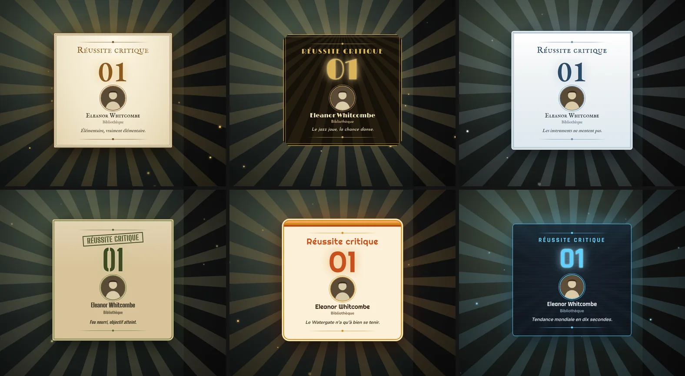</p>

- La carte apparaît en se retournant, dans un éclat de lumière.
- Derrière elle, des rayons tournent lentement et des étincelles montent.
- Le résultat (**01**) scintille.
- Un arpège de cloches retentit et l'écran vibre légèrement.

### Maladresse

<p align="center">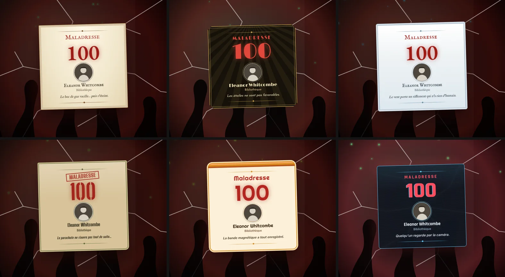</p>

- La carte tombe du haut de l'écran et rebondit, légèrement de travers.
- L'écran se fissure, des tentacules surgissent du bas et des cendres verdâtres tombent.
- Le fond pulse en rouge sombre et la carte vacille de temps en temps.
- Un grondement sourd retentit et l'écran tremble fortement.

### Ce que montre chaque carte

- le **résultat** du dé ;
- le **portrait** et le **nom** de l'investigateur ;
- la **compétence** lancée ;
- une **phrase** tirée au hasard, propre à l'époque. Par exemple :
  - *« Tekeli-li ! Tekeli-li ! »* pour une maladresse dans les Montagnes ;
  - *« Mission accomplie. »* pour une réussite critique en 1940.

Un clic sur la carte la ferme. Sinon, elle disparaît d'elle-même au bout de quelques secondes.

---

## Six habillages d'époque

| Époque | Habillage | Polices |
|---|---|---|
| **1890 — Gaslight** | papier ivoire, double filet de cuivre, petites capitales | IM Fell English, EB Garamond |
| **Années 20-30** | noir et or Art déco, coins coupés, soleil rayonnant | Limelight, Josefin Sans |
| **Montagnes Hallucinées** | carnet d'expédition polaire, bleu glacier, neige | IM Fell English, EB Garamond |
| **1940** | chemise de dossier kaki, titre en tampon | Big Shoulders Stencil, Oswald |
| **Années 70** | crème, bandes orange et brunes, formes arrondies | Righteous, Nunito |
| **Époque moderne** | écran de verre fumé, lignes cyan, brouillage sur les maladresses | Rajdhani, Inter |

<details>
<summary><strong>Voir chaque carte en grand</strong></summary>

| | Réussite critique | Maladresse |
|---|---|---|
| **1890** | 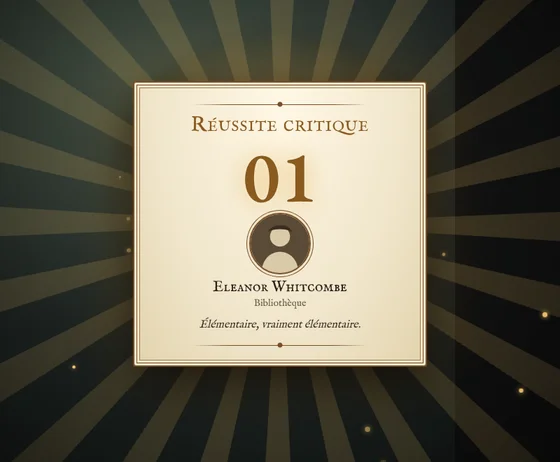 | 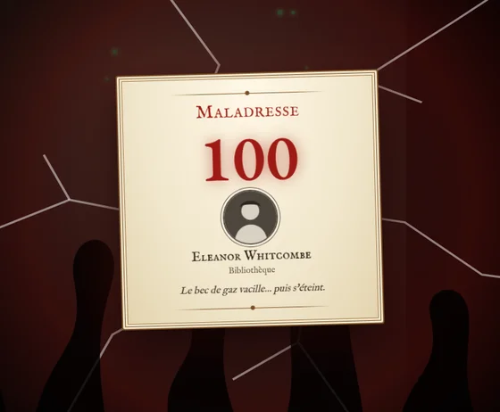 |
| **Années 20-30** | 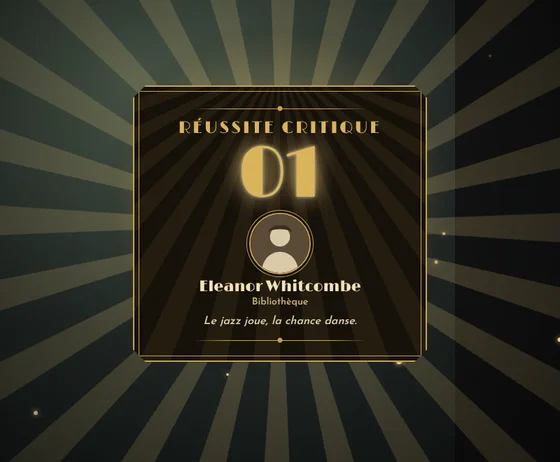 | 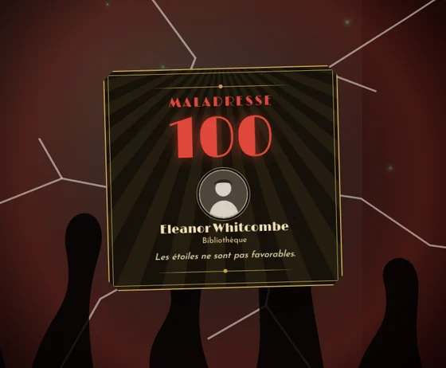 |
| **Montagnes Hallucinées** | 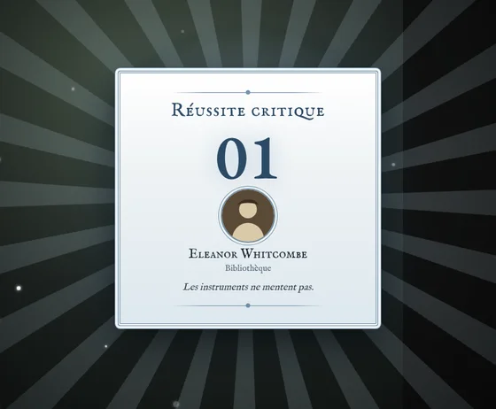 | 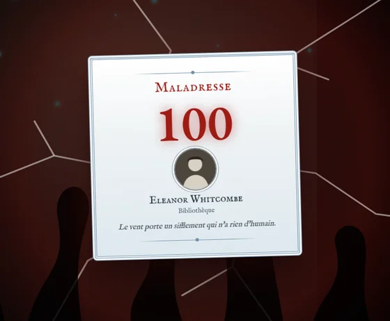 |
| **1940** | 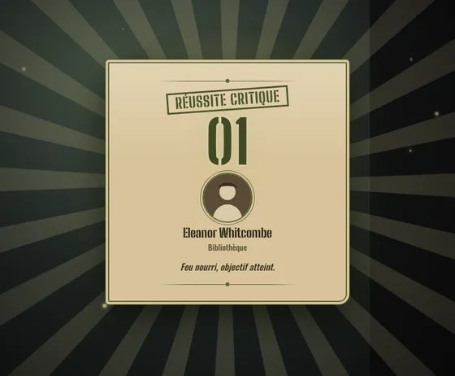 | 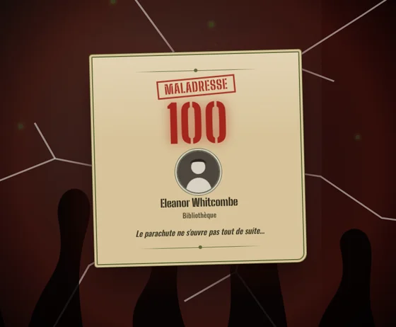 |
| **Années 70** | 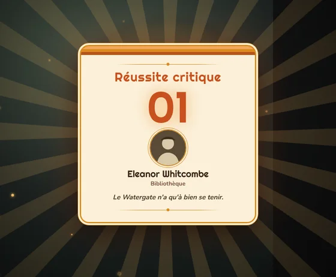 | 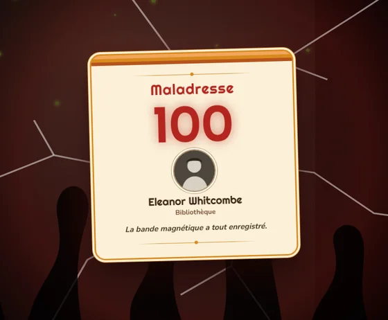 |
| **Époque moderne** | 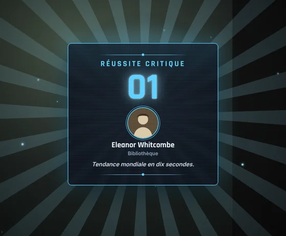 | 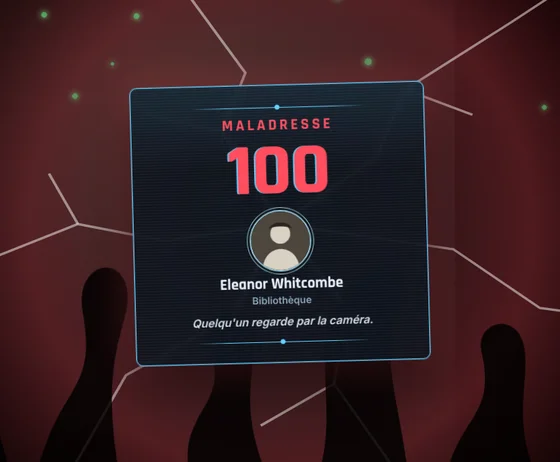 |

</details>

### Le bon habillage, tout seul

- **Avec CoC7**, la carte suit le thème du chat du module [CoC7 — Cartes de chat thématiques](https://github.com/magisterphamtom/coc7-cartes-chat). Si tu utilises la bascule d'époque, la carte change avec elle.
- **Avec Investigateurs de l'Ombre**, la carte suit l'époque de l'investigateur et l'ambiance de la campagne. Un investigateur de 1890 aura toujours sa carte victorienne, même dans un monde réglé sur une autre époque.
- Le Gardien peut aussi **imposer un habillage** dans les réglages.

---

## Réglages

**Pour le Gardien** (réglages du monde) :
- activer ou non la carte des réussites critiques, et celle des maladresses ;
- afficher aussi les cartes pour les **PNJ**, ou les réserver aux investigateurs des joueurs ;
- choisir l'**habillage** : automatique ou imposé ;
- remplacer les sons intégrés par **tes propres fichiers audio**, un pour chaque carte.

**Pour chaque joueur** (réglages personnels) :
- afficher ou non les cartes ;
- le **volume** et la **durée** d'affichage, de 2 à 8 secondes ;
- le **tremblement de l'écran** ;
- une **version sobre**, sans animation ni particules, pour le confort visuel. Elle s'active aussi d'elle-même si l'ordinateur est réglé pour réduire les animations.

La carte ne s'affiche que chez les joueurs qui voient le jet : un jet secret du Gardien reste secret.

---

## Essayer sans attendre le prochain 01

Crée une macro de script avec :

```js
game.modules.get("critiques-du-mythe").api.tester("critical")   // réussite critique
game.modules.get("critiques-du-mythe").api.tester("fumble")     // maladresse
```

Pour voir un habillage précis : `tester("fumble", "montagnes")`. Les noms possibles sont `gaslight`, `jazz`, `montagnes`, `guerre`, `seventies` et `moderne`.

---

## Installation

Dans Foundry : **Modules › Installer un module**, puis colle l'adresse du manifeste :

```
https://github.com/magisterphamtom/critiques-du-mythe/releases/latest/download/module.json
```

Active ensuite **Critiques du Mythe** dans ton monde.

**Configuration requise**
- Foundry VTT v13 ou v14 ;
- le système **CoC7** (8.x) ou **Investigateurs de l'Ombre** (0.12 ou plus).

**Recommandé avec CoC7** : [CoC7 — Cartes de chat thématiques](https://github.com/magisterphamtom/coc7-cartes-chat), pour que l'habillage suive tes thèmes.

**Fonctionne avec** :
- [CoC7 — Fenêtre de jet thématique](https://github.com/magisterphamtom/coc7-fenetre-jet) ;
- [Combat Cthulhu HUD](https://github.com/magisterphamtom/combatcthud) ;
- Dice So Nice!

---

## Licence

- **Code** : licence MIT.
- **Polices** : licence SIL Open Font License 1.1. Les licences sont dans le dossier `fonts/`.
- **Sons** : produits en direct par le navigateur, aucun fichier audio n'est fourni.

<sub>Les images de cette page sont des rendus du module dans un navigateur, avec un investigateur d'exemple.</sub>
